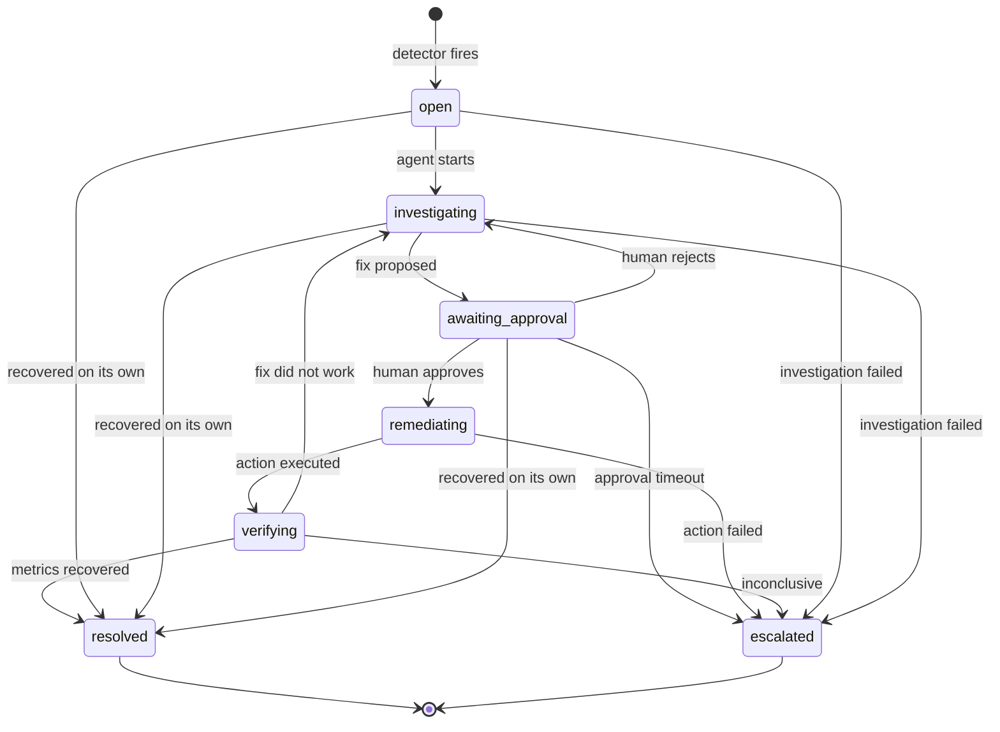

# Incident state machine

Every status change goes through `opspilot/incidents/state_machine.py::transition()`. The rules are checked
inside the database transaction (row locked with `FOR UPDATE`), an illegal move raises `IllegalTransition`
and changes nothing, and every move is written to `incident_events` with who did it and why.

`resolved` and `escalated` are final. A new incident can open for the same service afterwards.

## Why a state machine
- An AI agent must not be able to jump straight from "open" to "run the fix". The only road to
  `remediating` goes through `awaiting_approval`, and the Week 7 executor will additionally check the
  approval record itself.
- Failure paths (rejection, timeout, failed action, inconclusive verification) are explicit instead of
  being left to whatever the code happens to do.
- The audit trail makes every incident reviewable afterwards.

## One active incident per service
A partial unique index (`uq_one_active_incident`) lets the database guarantee there is never more than one
non-final incident for a service. Repeated detector signals attach to the existing incident instead of
creating duplicates, even if two workers run at once.
